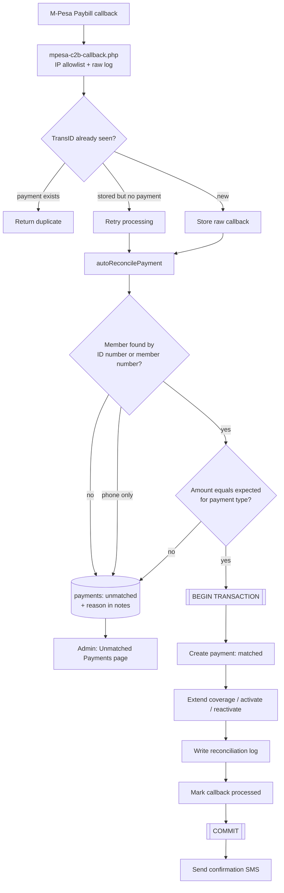
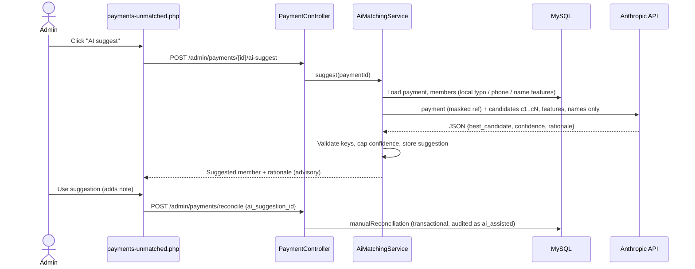
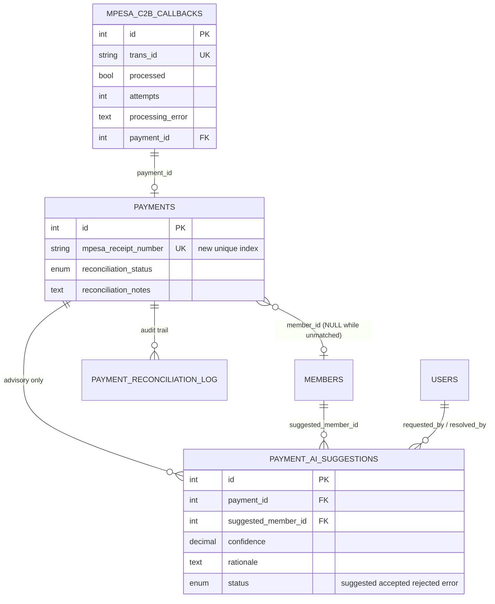
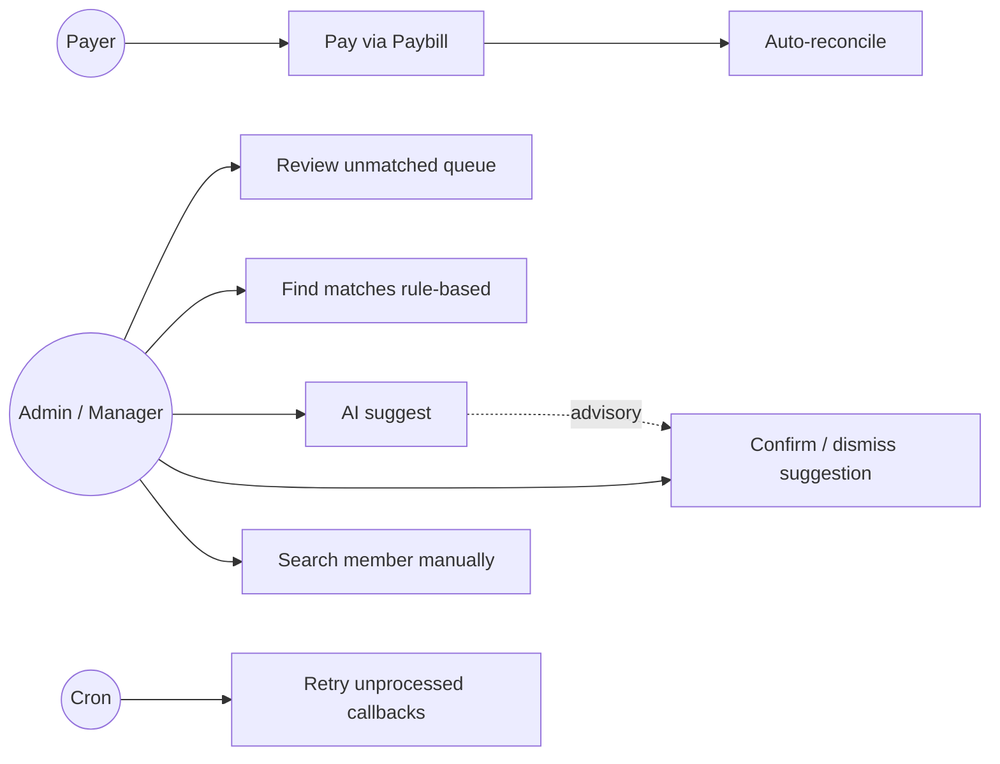

# Payment Reconciliation: Integrity Rules and AI-Assisted Matching

Applies to migration `031_reconciliation_integrity_and_ai_suggestions.sql`.

## 1. Principles

1. **Money is posted only by deterministic code.** The AI never creates a payment, extends coverage or changes a member.
2. **Weak evidence goes to a human.** Phone-only matches and amount mismatches are queued as `unmatched` with a written reason.
3. **Every step is atomic and auditable.** Posting, side-effects, the audit row and the callback link commit together or not at all.
4. **AI output is untrusted.** It is schema-validated, limited to the candidates it was offered, and its confidence is capped by facts computed locally.

## 2. Data flow (C2B callback)



A failure anywhere inside the transaction rolls everything back. The raw callback stays `processed = 0` with `processing_error` set, and `cron/retry_unprocessed_c2b.php` re-attempts it (up to 5 times).

## 3. AI-assisted suggestion flow



### What the model receives

| Sent | Never sent |
|---|---|
| Amount, sender name, **masked** account reference (last 3 chars) | National ID numbers |
| Candidate key (`c1`...), first/last name, status | Phone numbers, database ids |
| Local features: edit distance, phone-match flag, shared name tokens, amount-matches-expected | Email, address, payment history |

### Guardrails

- Unknown candidate key in the reply is discarded, so the model cannot introduce a member.
- Non-JSON or malformed output fails closed to "no suggestion".
- Confidence is capped at 85. If the chosen candidate has no hard evidence (account distance over 2, no phone match, no shared name token) it is capped at 30. This limits prompt injection through the payer-controlled sender name.
- Suggestions are cached for 10 minutes per payment to limit API cost.

## 4. Data model



## 5. Use cases



## 6. Configuration

```
AI_RECONCILIATION_ENABLED=true     # off by default
ANTHROPIC_API_KEY=...              # server-side only, never committed
AI_RECONCILIATION_MODEL=claude-sonnet-5-5
```

With the flag off or no key, the "AI suggest" button reports that suggestions are not enabled and everything else behaves normally.

## 7. Deployment checklist

1. Run the **preflight query** at the top of migration 031 and resolve any duplicate receipts.
2. Apply the migration.
3. Add the cron entry: `*/10 * * * * php /path/to/Shena/cron/retry_unprocessed_c2b.php`
4. Set the `.env` values only when ready to enable AI.
5. Run `php tests/reconciliation_logic_test.php`.

## 8. Known limits and follow-ups

- Amount rule: `monthly` payments must equal `members.monthly_contribution`. Members with no contribution on file are still auto-posted (flagged as unknown) to avoid flooding the queue. Multi-month payments now go to review instead of silently granting one month.
- The STK push path and `PaymentController` still apply membership side-effects separately; consolidating them into this service is a recommended next step.
- New admin JSON endpoints follow the existing pattern (session role check, no CSRF token). Adding CSRF to all admin JSON endpoints is a separate hardening task.
- Statement-upload reconciliation (diff against the M-Pesa statement to find callbacks that never arrived) is not in this PR.
